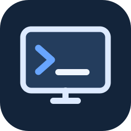

# Academic Automation Kit



**Español** · [English](README.en.md) · [Patrocinar](https://github.com/sponsors/tec-2022)

[](docs/media/demo.mp4)

> El video enlazado es una presentación promocional, no una grabación de la interfaz. La documentación de diseño y el recorrido de pantallas están en [docs/UI_DESIGN.md](docs/UI_DESIGN.md).

[](https://github.com/tec-2022/-academic-automation-kit/actions/workflows/validate.yml)


> Herramienta creada y mantenida por **Fredy Luis Vidalón Lozano** para preparar, configurar, diagnosticar y automatizar computadoras en contextos universitarios.

**Academic Automation Kit** incluye una interfaz gráfica para Windows, perfiles por carrera, auditoría del equipo antes de instalar, validación de paquetes mediante Winget, limpieza opcional de caché propia, comprobaciones posteriores a la instalación, diagnóstico de conflictos y una capa de IA local opcional que nunca sustituye al motor determinista.

## Autor

**Fredy Luis Vidalón Lozano**  
Creador y desarrollador de Academic Automation Kit.

Repositorio: `tec-2022/-academic-automation-kit`

## Interfaz gráfica

La aplicación de escritorio está implementada con Python + Tkinter y no requiere dependencias gráficas externas. Su interfaz utiliza navegación lateral y un sistema visual consistente: fondos claros, paneles de contenido, acciones primarias, estados de seguridad y progreso visible. En Windows puede abrirse con doble clic en:

```text
Abrir-Academic-Toolkit.bat
```

O desde terminal:

```powershell
python start_gui.py
```

La interfaz incluye funciones reales, no tarjetas vacías:

- **Inicio:** panel principal, accesos directos y diagnóstico básico del equipo.
- **Preparar mi PC:** selección de carrera, niveles de software, auditoría de Winget, compatibilidad e instalación con progreso por paquete. Se puede solicitar detener la cola *después* del instalador en curso.
- **Programas:** búsqueda real en Winget con nombre e identificador, selección explícita, instalación y desinstalación del paquete seleccionado.
- **Mantenimiento:** vista previa y borrado explícito solo de archivos .tmp/.cache antiguos creados dentro de la carpeta temporal de esta aplicación.
- **Asistente:** predicción local inmediata y uso opcional de IA local mediante Ollama cuando las reglas no bastan.
- **IA local opcional:** valida Ollama en Winget antes de instalar y descarga el modelo ligero solo con confirmación del usuario.

Las operaciones lentas se ejecutan en segundo plano para que la ventana no quede congelada durante búsquedas, auditorías o instalaciones.
La barra inferior distingue operaciones indeterminadas de la preparación por carrera, que informa cuántos paquetes se han procesado. El panel lateral ofrece atajos de teclado **Ctrl+1 a Ctrl+5**.

## Preparar una PC según la carrera

El flujo principal es: **detectar → auditar → mostrar plan → confirmar → preparar → instalar → verificar**.

También puede usarse por terminal:

```powershell
python scripts/labs/career-pc-prep.py careers
python scripts/labs/career-pc-prep.py plan informatics-engineering
python scripts/labs/career-pc-prep.py prepare informatics-engineering
```

El comando `plan` no instala nada. Antes de ofrecer un paquete, el motor comprueba en tiempo de ejecución que su identificador exista en Winget y detecta si ya está instalado. Los paquetes incompatibles o no resolubles se bloquean en lugar de simular una instalación.

### Perfiles incluidos

| Carrera / perfil | Enfoque principal |
|---|---|
| Ingeniería Informática | Programación, web, bases de datos, APIs y contenedores |
| Ingeniería en Sistemas Computacionales | Java, desarrollo, bases de datos, APIs y contenedores |
| Ingeniería Industrial | Python, R, RStudio, análisis y documentación |
| Ingeniería Civil | FreeCAD, QGIS, modelado, automatización y documentación |
| Ingeniería Mecatrónica | Arduino, KiCad, FreeCAD, Python y control de versiones |
| Ingeniería Electrónica | PCB, microcontroladores, programación y CAD |
| Ciencia de Datos | Python, Miniconda, R, RStudio y entornos reproducibles |

Cada perfil separa herramientas en `essential`, `recommended` y `specialized`. Los paquetes especializados pueden declarar requisitos de RAM o virtualización para evitar instalaciones inadecuadas.

## Preparación segura

La preparación del equipo **no borra temporales automáticamente**. La sección Mantenimiento opera únicamente sobre archivos `.tmp` y `.cache` de al menos siete días dentro de la carpeta de caché propia de Academic Automation Kit; nunca recorre las carpetas Temp generales de Windows ni elimina subdirectorios. Para limpieza general usa **Configuración de Windows → Sistema → Almacenamiento**.

La limpieza propia también es opcional en CLI: `python scripts/labs/career-pc-prep.py prepare informatics-engineering --clean-cache`. Sin esa opción no se realiza ninguna limpieza.

Para instalaciones relevantes, el resultado de Winget no se considera suficiente: cuando existe un `health_check`, el toolkit intenta ejecutar la herramienta instalada (`python --version`, `git --version`, `node --version`, etc.) y marca **OK** o **NECESITA ATENCIÓN**.

## MySQL y conflictos reales

El perfil de informática integra MySQL como paquete diagnosticable. El módulo MySQL Smart Setup permanece separado porque antes de configurarlo debe revisar XAMPP/MariaDB/MySQL existentes, servicios, puertos y exposición de red. **Por defecto escucha únicamente en 127.0.0.1**; el acceso LAN requiere la opción explícita `-AllowLan`. No se debe usar como servidor público de Internet.

## IA local opcional y rápida

La IA no es obligatoria. Las acciones conocidas se resuelven primero mediante reglas y funciones auditables. La IA local solo entra como fallback para interpretar lenguaje natural ambiguo, devuelve intenciones permitidas y no recibe una ruta para ejecutar comandos arbitrarios como administrador.

El adaptador local está configurado para baja latencia: contexto pequeño, salida corta, temperatura 0, `keep_alive` y modelo ligero configurable. Si el usuario decide no descargar IA, el resto de la plataforma sigue funcionando.

## Inicio rápido del catálogo clásico

```bash
git clone https://github.com/tec-2022/-academic-automation-kit.git
cd ./-academic-automation-kit
python toolkit.py list
```

El launcher de terminal también expone `career-pc-prep` en la categoría `pc-preparation`.

## Automatizaciones adicionales

| Área | Automatización | Uso |
|---|---|---|
| Preparación PC | Career PC Prep | Audita y prepara Windows según carrera |
| Estudiantes | Semester Folder Builder | Crea carpetas ordenadas por materia |
| Estudiantes | Assignment Renamer | Renombra entregas con modo `--dry-run` |
| Estudiantes | Deadline Planner | Genera calendarios `.ics` |
| Docentes | Gradebook Calculator | Calcula calificaciones ponderadas |
| Docentes | Attendance Summary | Resume asistencia y alertas |
| Docentes | Random Team Maker | Forma equipos reproducibles |
| Docentes | Rubric Generator | Genera rúbricas Markdown |
| Investigación | Citation Deduplicator | Detecta referencias repetidas |
| Investigación | Literature Matrix | Genera matrices de literatura |
| Datos | CSV Cleaner | Limpia CSV sin sobrescribir originales |
| Datos | Student Data Anonymizer | Seudonimiza identificadores |
| Laboratorios | MySQL Smart Setup | Prepara MySQL Community de forma aislada |

## Estructura

```text
.
├─ Abrir-Academic-Toolkit.bat    # Lanzador de Windows
├─ start_gui.py                  # Entrada de la app gráfica
├─ toolkit.py
├─ catalog.json
├─ academic_toolkit/
│  ├─ desktop_app.py
│  ├─ careers.json
│  ├─ career_engine.py
│  ├─ health_checks.py
│  ├─ software_manager.py
│  ├─ system_prepare.py
│  ├─ predictor.py
│  └─ ai.py
├─ scripts/
│  ├─ students/
│  ├─ teachers/
│  ├─ research/
│  ├─ data/
│  └─ labs/
├─ tests/
├─ docs/
└─ .github/workflows/validate.yml
```

## Seguridad y calidad

Los cambios de sistema deben validarse antes de ejecutarse, operar con mínimos privilegios y evitar abrir servicios a Internet por defecto. Los ejemplos no contienen información académica real y la IA no puede convertirse en un ejecutor privilegiado de comandos generados.

GitHub Actions compila `academic_toolkit`, scripts y tests, valida el JSON de perfiles, ejecuta smoke tests y analiza la sintaxis de PowerShell en Windows. También comprueba la construcción de las cinco pantallas y los estados iniciales de botones y progreso en Windows.

## Licencia

MIT © 2026 **Fredy Luis Vidalón Lozano**.
